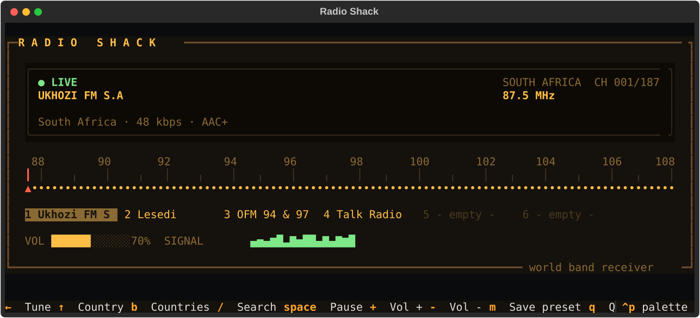
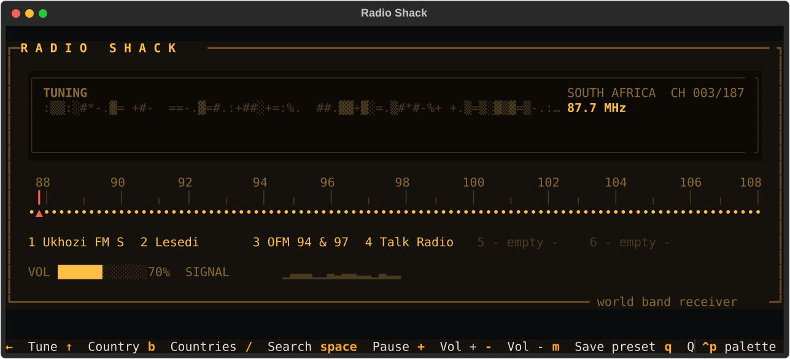
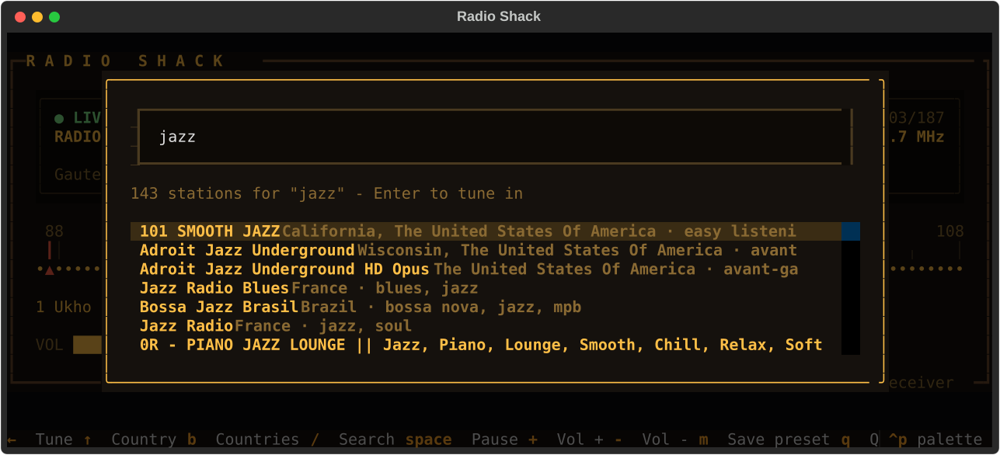

<div align="center">

# 📻 R A D I O &nbsp; S H A C K

**An old-school world band radio for your terminal.**<br>
Turn the dial, hear the static, and lock onto live stations from 240 countries.




</div>

---

## Why

Most internet radio apps are a search box and a long list. Radio Shack works like the set on your grandparents' kitchen shelf instead: each country is a band, every station sits somewhere on an FM dial, and you find things by **sweeping the needle and listening**. No ads, no accounts and no browser tabs. It's just a terminal and a lot of radio.

## Features

|  |  |
| --- | --- |
| 🎛️ **A real dial** | Every station in a country is spread across 87.5–108 MHz. Arrow keys move the needle. |
| 📡 **Static between stations** | The display fills with noise while you tune. A station only locks in once the needle stops, so sweeping never starts a pile of streams. |
| 🌍 **240 countries** | Flip through countries with ↑ ↓, or press `B` to pick one from a list. |
| 🔎 **Search everything** | Press `/` to search every station by name, city, genre or country, and jump straight to it. |
| 🔘 **Preset buttons** | `M` then `1`–`6` saves a station, like the buttons on an old car radio. Presets work across countries. |
| 🎵 **Now playing** | Shows the current song whenever the station sends it. |
| 💾 **Remembers you** | Volume, presets and your last station are saved, so it opens where you left off. |

<table>
<tr>
<td width="50%"><br><sub><b>Tuning</b>: static until the needle settles</sub></td>
<td width="50%"><br><sub><b>Search</b>: every station in the directory</sub></td>
</tr>
</table>

## Quick start

You need **Python 3.9+** and **[mpv](https://mpv.io)**, the audio engine that plays the streams.

<details open>
<summary><b>Windows</b></summary>

```powershell
winget install shinchiro.mpv          # then open a new terminal
git clone https://github.com/BladeIV/radioshack.git
cd radioshack
python -m venv .venv
.venv\Scripts\pip install -r requirements.txt
.\radioshack.cmd
```
</details>

<details>
<summary><b>macOS</b></summary>

```bash
brew install mpv
git clone https://github.com/BladeIV/radioshack.git && cd radioshack
python3 -m venv .venv && .venv/bin/pip install -r requirements.txt
.venv/bin/python radio.py
```
</details>

<details>
<summary><b>Linux</b></summary>

```bash
sudo apt install mpv        # or your distro's package manager
git clone https://github.com/BladeIV/radioshack.git && cd radioshack
python3 -m venv .venv && .venv/bin/pip install -r requirements.txt
.venv/bin/python radio.py
```
</details>

> **No sound?** If the display says **NO AUDIO**, mpv wasn't found. Make sure `mpv --version` works in a fresh terminal.

## Controls

| Key | Action |
| :-: | --- |
| <kbd>←</kbd> <kbd>→</kbd> | Turn the dial |
| <kbd>PgUp</kbd> <kbd>PgDn</kbd> | Jump 10 stations |
| <kbd>↑</kbd> <kbd>↓</kbd> | Previous / next country |
| <kbd>B</kbd> | Pick a country from a list |
| <kbd>/</kbd> | Search all stations |
| <kbd>Space</kbd> | Pause / resume |
| <kbd>+</kbd> <kbd>−</kbd> | Volume |
| <kbd>M</kbd> then <kbd>1</kbd>–<kbd>6</kbd> | Save the current station to a preset |
| <kbd>1</kbd>–<kbd>6</kbd> | Play a preset |
| <kbd>Q</kbd> | Quit |

## How it works

```
 Radio Browser API  ──►  radio.py (Textual UI)  ──►  mpv (in the background)
 stations, countries      dial · display · presets    plays the stream over JSON IPC
```

- **Stations** come from the open, community-run [Radio Browser](https://www.radio-browser.info) directory. Broken streams are filtered out, and repeat listings of the same station are merged.
- **The dial** maps a country's stations, most popular first, evenly onto the FM band. Countries with hundreds of stations get a crowded dial, just like a big city.
- **Audio** runs in a hidden mpv process. The app sends it commands over mpv's JSON IPC channel, which is also how it reads the now-playing song.
- **Settings** live in `~/.radioshack.json`.

## Also in this repo: the globe

[`index.html`](index.html) is the first version of the project: a dark-themed 3D globe of stations that runs in the browser. Serve the folder (`python -m http.server`) and open it to spin the planet.

## Credits

- 🌐 **[Radio Garden](https://radio.garden)** was the inspiration. Their globe of live radio is what started this project, and it's well worth a visit. Radio Shack is an independent project and is not affiliated with or endorsed by Radio Garden.
- 📚 **[Radio Browser](https://www.radio-browser.info)** provides the free, open station directory behind every station on the dial.
- 🖥️ **[Textual](https://textual.textualize.io)** powers the terminal UI.
- 🔊 **[mpv](https://mpv.io)** does the actual listening.

<div align="center">
<br>
<sub>Made for late nights and long dial sweeps.</sub>
</div>
